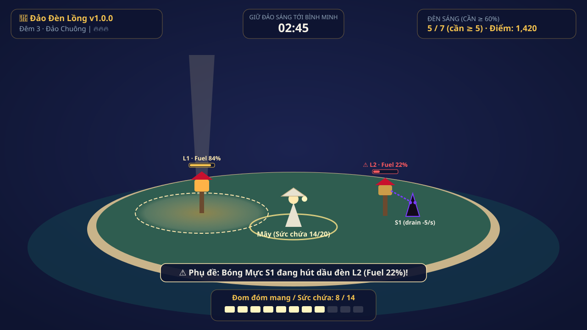

# Đảo Đèn Lồng v1.0.0 — Day 12 AI SDLC

> **Học viên:** Lê Văn Hoàng · **MSSV:** `2A202603357` · **Lớp:** `K5-L3A`  
> **Video demo:** [`docs/demo/demo.mp4`](docs/demo/demo.mp4) · **Gói phát hành tĩnh/thực thi:** [`dist/dao-den-long-v1.0.0.zip`](dist/dao-den-long-v1.0.0.zip)  
> **Trạng thái hiện tại:** Hoàn thành toàn bộ **4 Phase (`phase-1`, `phase-2`, `phase-3`, `phase-4`) & Release `v1.0.0`** (`Test Contract v1.3`).



---

## 1. Giới thiệu & Yêu cầu Hệ thống

**Đảo Đèn Lồng (`v1.0.0`)** là game 3D góc nhìn thứ ba gồm chiến dịch **3 Đêm**, nơi người chơi điều khiển **Mây** (đội nón lá treo chiếc đèn lồng nhỏ) thu thập đom đóm, thắp đèn, châm dầu và giữ cho **ít nhất 60% số Đèn Lồng Lớn** trên đảo còn cháy sáng khi bình minh tới (`dawn_survived`):
- **Đêm 1 — Đảo Bến (`240s`, cần giữ sáng `≥ 3/5` đèn):** Hòn đảo tròn bán kính `40m` giữa biển mây với bến gỗ hướng Nam.
- **Đêm 2 — Đảo Cau (`270s`, cần giữ sáng `≥ 4/6` đèn):** Hai hòn đảo tròn bán kính `28m` nối bằng cầu tre và 2 **Bệ Nhảy Gió**, xuất hiện **Gió Lạc** cướp đom đóm và **Bùa Gió** ở giữa cầu.
- **Đêm 3 — Đảo Chuông (`300s`, cần giữ sáng `≥ 5/7` đèn):** Đảo `45m` chia **3 tầng độ cao (`0m · 3m · 6m`)** với 2 dốc đá (`30°` và `150°`), Bệ Nhảy lên đỉnh **Tháp Chuông**, 2 Bùa Gió, Gió Lạc và **Gió Mạnh** thổi mỗi `30 giây`.

### Yêu cầu hệ thống
- **Hệ điều hành:** macOS, Linux, hoặc Windows (kiểm thử đầy đủ trên Windows 11 & Ubuntu Linux CI).
- **Runtime:** **Python `3.10+`** (chỉ sử dụng thư viện chuẩn `stdlib`, **không** cần cài thêm bất kỳ gói `pip` hay `npm` nào).
- **Trình duyệt (cho bản 3D):** Chrome, Edge, Firefox hoặc Safari có hỗ trợ WebGL (`Three.js r149` đã được đóng gói sẵn offline tại [`web/vendor/three.min.js`](web/vendor/three.min.js)).
- **Ghi chú về VSync trong Benchmark:** Bộ chạy benchmark CLI (`python3 -m src.bench`) chạy vòng lặp đo khung hình độc lập với `vsync_off: true` (sử dụng đồng hồ độ phân giải cao `time.perf_counter()`). Khi chạy chế độ benchmark trực quan trên trình duyệt (`http://127.0.0.1:8080/?bench=1&seed=42&duration=30`), trình duyệt web mặc định khóa `requestAnimationFrame` theo tần số quét màn hình của hệ điều hành trừ khi mở trình duyệt với cờ `--disable-frame-rate-limit --disable-gpu-vsync`.

---

## 2. Cài đặt và Chạy (Tối đa 3 lệnh trên máy sạch)

```bash
git clone https://github.com/hoanglv2k9/K5-L3A-DAY12-LeVanHoang-2A202603357-AI-SDLC-Dao-Den-Long.git
cd K5-L3A-DAY12-LeVanHoang-2A202603357-AI-SDLC-Dao-Den-Long
python3 -m src.web_server
```

Mở trình duyệt tại **http://127.0.0.1:8080** (trên Windows có thể dùng `python` thay cho `python3`).

---

## 3. Điều khiển & Tính năng Dễ tiếp cận (Accessibility)

Toàn bộ **9 hành động** dưới đây đều có thể **Đổi phím tùy ý** trong mục **⚙ Cài đặt & Đổi phím** (có tự động phát hiện trùng phím, nút *"Khôi phục mặc định"* và lưu trong `localStorage`):

| Phím mặc định | Hành động |
|---|---|
| `W / A / S / D` (hoặc phím Mũi tên) | Di chuyển Mây 4 hướng theo góc nhìn camera (`6.0 m/s`, hoặc `7.2 m/s` khi có Bùa Gió) |
| Kéo chuột trái (hoặc `[` / `]`) | Xoay góc nhìn camera 3D (`cam_yaw_deg`, chỉnh độ nhạy `0.3x – 2.5x` trong Cài đặt) |
| `Space` | Nhảy (`vy = 7.0 m/s`, trọng lực `-20 m/s²`) |
| `Shift` | **Lướt (Dash)** — `14.0 m/s` trong `0.2s`, hồi chiêu `1.5s` (`0s` khi có Bùa Gió), giữ nguyên độ cao trên không |
| `E` (hoặc `F`) | **Thắp mới (`10` đom đóm) / Thắp lại đèn từng sáng (`5` đom đóm) / Châm dầu (`+10 fuel/đom đóm`)** trong bán kính `2.0m` |
| `Q` (hoặc Chuột phải / `X`) | **Tỏa sáng (Light Pulse)** — tốn `3` đom đóm, bán kính 3D `5.0m`, choáng `2.0s` & đẩy lùi `4.0m` trong `15 tick` đầu; thưởng `+15` điểm nếu ngắt Bóng Mực đang hút dầu (`drain`) |
| `Esc` (hoặc `P`) | **Tạm dừng (Pause)** — đóng băng toàn bộ nhịp mô phỏng |
| `M` | Bật / tắt nhanh âm thanh |

### Hỗ trợ Dễ tiếp cận (Ticket-03 & Ticket-04)
- **Bảng màu dễ phân biệt (Chế độ mù màu):** Đổi mắt/viền Bóng Mực sang `#00B3FF`, cảnh báo UI sang `#FFFFFF` kèm biểu tượng `⚠`; đèn tắt bị **xẹp 20% chiều cao** kèm **vết rách trên giấy đèn**; đèn sắp hết dầu (`fuel < 30`) nhấp nháy chậm `1 Hz`.
- **Phụ đề & chỉ báo hình ảnh:** Hiện phụ đề trực quan kèm **mũi tên chỉ hướng ở mép màn hình** khi Bóng Mực xuất hiện, khi gió mạnh sắp thổi, trong 10 giây cuối, và khi đèn có `fuel < 30`.
- **Giảm chuyển động:** Tắt rung camera và hiệu ứng chớp màn hình khi bị thương.
- **Cỡ chữ UI:** Mặc định tối thiểu **`18 px`** ở `1280×720`, kèm tuỳ chọn **Cỡ chữ lớn (`×1.25`)**.

---

## 4. Chạy Test, Headless, Benchmark, Soak Test & Xuất Bảng Xếp Hạng (Contract v1.3)

```bash
# 1. Cổng kiểm chứng tổng hợp (29 unit/CLI test + 8 kịch bản headless + determinism + perf + bench + soak)
python3 scripts/verify_all.py --phase 4

# 2. Chạy Headless CLI (Test Contract v1.0 - v1.3)
python3 -m src.headless --seed 42 --night 1 --ticks 300 --out tmp/night1.jsonl --snapshot-every 60

# 3. Chạy Benchmark chuẩn 1280x720 (Đêm 1: 200 Bóng Mực wander, 100 Đom đóm, 3 đèn sáng, 3s warmup + 30s đo)
python3 -m src.bench --seed 42 --duration 30 --out bench.json

# 4. Chạy Soak Test 10 Đêm liên tiếp trong cùng một tiến trình
python3 -m src.soak --seed 7 --nights 10 --out soak.json

# 5. Xuất Bảng xếp hạng cục bộ Top 10 ra file JSON
python3 -m src.web_server --export-leaderboard out.json
```

---

## 5. Tài liệu, ADR, Changelog, Retro, Bằng chứng & Harness AI

- **Bản Tổng kết 4 Phase (Retrospective):** [`docs/RETROSPECTIVE.md`](docs/RETROSPECTIVE.md).
- **Quyết định thiết kế (ADR Phase 3):** [`docs/adr/0001-lantern-fuel-and-dawn-survival.md`](docs/adr/0001-lantern-fuel-and-dawn-survival.md).
- **Nhật ký thay đổi 4 Phase & Breaking Changes:** [`CHANGELOG.md`](CHANGELOG.md).
- **Số liệu Benchmark & Soak Test đã chạy:** [`bench.json`](bench.json) (`avg_fps = 124.7`, `p1_low_fps = 31.2`, `load_ms = 3ms`) và [`soak.json`](soak.json) (`10` Đêm, `crashes = 0`, `mem_start_mb = 24.0`, `mem_end_mb = 24.0`).
- **Ảnh chụp kiểm chứng trực quan (`1280×720`):** [`docs/proof/phase-4/screenshots/`](docs/proof/phase-4/screenshots/) & bảng truy vết chi tiết tại [`docs/notes/phase-4.md`](docs/notes/phase-4.md).
- **Bằng chứng & ghi chép theo từng Phase:**
  - Phase 1 (`phase-1`): [`docs/proof/phase-1/summary.md`](docs/proof/phase-1/summary.md) & [`docs/notes/phase-1.md`](docs/notes/phase-1.md).
  - Phase 2 (`phase-2`): [`docs/proof/phase-2/summary.md`](docs/proof/phase-2/summary.md) & [`docs/notes/phase-2.md`](docs/notes/phase-2.md).
  - Phase 3 (`phase-3`): [`docs/proof/phase-3/summary.md`](docs/proof/phase-3/summary.md) & [`docs/notes/phase-3.md`](docs/notes/phase-3.md).
  - Phase 4 (`phase-4` & `v1.0.0`): [`docs/proof/phase-4/summary.md`](docs/proof/phase-4/summary.md) & [`docs/notes/phase-4.md`](docs/notes/phase-4.md).
- **Harness AI:** [`AGENTS.md`](AGENTS.md), skill [`.agents/skills/verify-phase/SKILL.md`](.agents/skills/verify-phase/SKILL.md), pre-commit hook [`.githooks/pre-commit`](.githooks/pre-commit), CI [`.github/workflows/ci.yml`](.github/workflows/ci.yml).
- **Bản quyền & Ghi nguồn:** [`LICENSE`](LICENSE) (MIT), [`CREDITS.md`](CREDITS.md).
